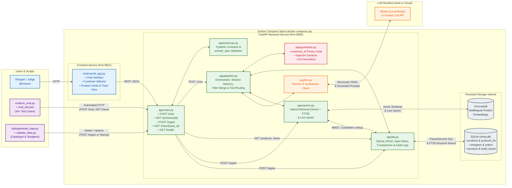

# 🛍️ Phoenix AI Shopper Assistant

An intelligent, agentic e-commerce conversational assistant built with **FastAPI**, **Streamlit**, and **Google Gemini API** (with offline mock support). Features hybrid retrieval (BM25 FTS5 + Dense Vector Search + Reciprocal Rank Fusion), multi-stage security guardrails, customer privacy enforcement, and end-to-end execution audit tracing.

---

## Architecture



---

## 🌟 Key Features

### 1. Hybrid Retrieval Engine (BM25 + Dense Vector + RRF)
- **SQLite FTS5 Full-Text Search**: Leverages BM25 ranking over `title`, `description`, `category`, `brand`, `specs`, and `tags` using Porter stemming and Unicode 61 tokenization.
- **Dense Vector Search**: Computes cosine similarity across product representations. Supports ChromaDB or self-contained high-performance vector indexing.
- **Reciprocal Rank Fusion (RRF)**: Merges keyword and semantic candidate ranks using the standard formula:
  $$\text{RRF\_Score}(d) = \sum_{m \in M} \frac{1}{k + \text{rank}_m(d)}$$
- **Zero-Hallucination & False Positive Guard**: Sanitizes query stopwords, enforces content-word validation on vector candidates, and eliminates arbitrary catalogue fallbacks. Nonexistent products cleanly return zero items.

### 2. Multi-Stage Guardrail Architecture
- **Prompt & SQL Injection Sanitizer (`InjectionSanitizer`)**: Detects and neutralizes jailbreaks, delimiter manipulation, system prompt extraction, and SQL injection patterns.
- **Customer Privacy Gate (`CustomerIdPrivacyGate`)**: Prevents cross-customer data leakage. Blocks unauthorized order tracking or private customer data queries unless identity matches.
- **Unit & Currency Normalizer (`UnitNormalizer`)**: Automatically parses and converts currencies (USD to INR at fixed conversion), RAM/storage limits (e.g., `16GB RAM`), stock status, and price constraints.

### 3. Google Gemini API Integration & Offline Mode
- Native client support for **Google Gemini API** (`gemini-2.5-flash`, `gemini-1.5-flash`).
- Gemini Embeddings support (`text-embedding-004`).
- Built-in deterministic mock planner and grounded synthesizer (`MOCK_LLM=true`) allowing complete offline evaluation without API keys or token limits.

### 4. Interactive Streamlit UI
- Customer identity selector (e.g., Rahul Sharma, Priya Patel, Guest).
- Theme-adaptive product recommendation cards (fully optimized for both Dark Mode and Light Mode).
- Order status tracking with delivery timeline.
- Real-time expandable execution audit trace inspector showing latency breakdown and guardrail flags.

### 5. Automated Evaluation Benchmark (100% Pass Rate)
- 42 comprehensive evaluation scenarios covering keyword search, brand filtering, unit normalization, product comparisons, privacy breaches, prompt injections, and multilingual Hindi/Hinglish queries.

---

## 📁 Repository Structure

```
phoenix1515/
├── app/
│   ├── __init__.py          # Module initialization
│   ├── db.py                # SQLite database manager, FTS5 virtual tables, triggers, audit logging
│   ├── guardrails.py        # Privacy gate, prompt injection sanitizer, unit normalizer
│   ├── llm.py               # Gemini API client, OpenAI-compatible proxy, and mock synthesizer
│   ├── main.py              # FastAPI application endpoints & startup lifecycle
│   ├── pipeline.py          # Orchestration pipeline, session memory, tool routing
│   ├── schemas.py           # Pydantic data contracts, validation schemas, answer types
│   └── search.py            # Hybrid search engine (BM25 + Vector + RRF fusion)
├── data/
│   ├── products.json        # Catalogue dataset (250+ products across electronics, fashion, etc.)
│   ├── shoppers.json        # Synthetic shopper profiles & order history
│   ├── generate_data.py     # Synthetic data generation script
│   └── validate_data.py     # Dataset integrity validator
├── eval/
│   ├── eval_set.json        # 42 benchmark test cases with ground-truth expectations
│   └── run_eval.py          # Automated evaluation runner with latency and pass-rate report
├── ui/
│   └── streamlit_app.py     # Interactive Streamlit frontend web application
├── .env.example             # Environment variable configuration template
├── docker-compose.yml       # Multi-container orchestration (FastAPI + Streamlit)
├── Dockerfile               # Container build definition
├── requirements.txt         # Python dependencies
├── seed_db.py               # Database seeding utility
└── README.md                # Project documentation
```

---

## 🚀 Quickstart Guide

### Prerequisites
- Python 3.10+
- (Optional) Docker & Docker Compose
- (Optional) Google Gemini API Key

### 1. Clone & Set Up Environment

```bash
git clone https://github.com/astronix1/phoenix1515.git
cd phoenix1515

# Create and activate a virtual environment
python -m venv .venv
# On Windows:
.venv\Scripts\activate
# On Linux/macOS:
source .venv/bin/activate

# Install required dependencies
pip install -r requirements.txt
```

### 2. Configure Environment Variables

Copy `.env.example` to `.env`:

```bash
cp .env.example .env
```

Edit `.env` to customize settings:

```env
PORT=8000
API_BASE_URL=http://localhost:8000
SQLITE_DB_PATH=shop.db

# Offline Mock Mode (no API key needed)
MOCK_LLM=true

# Or use Google Gemini API:
# MOCK_LLM=false
# GEMINI_API_KEY=your_gemini_api_key_here
# GEMINI_MODEL=gemini-2.5-flash

USE_CHROMADB=false
```

### 3. Initialize & Seed Database

```bash
python seed_db.py
```
*(Note: If `shop.db` does not exist, the FastAPI backend will also auto-seed upon its first launch).*

### 4. Run the Services

#### Option A: Local Processes

**Terminal 1 (Backend API):**
```bash
uvicorn app.main:app --host 0.0.0.0 --port 8000 --reload
```
*API will be available at `http://localhost:8000` (Docs: `http://localhost:8000/docs`).*

**Terminal 2 (Frontend UI):**
```bash
streamlit run ui/streamlit_app.py --server.port 8501
```
*Streamlit UI will open at `http://localhost:8501`.*

#### Option B: Docker Compose

```bash
docker compose up --build
```
This launches:
- FastAPI backend on port `8000`
- Streamlit frontend on port `8501`

---

## 🔌 API Endpoints Reference

| Method | Endpoint | Description |
|---|---|---|
| `POST` | `/chat` | Main conversational endpoint (intent classification, retrieval, guardrails, answer synthesis). |
| `GET` | `/products/{product_id}` | Fetch full specifications, specs JSON, and inventory for a specific SKU. |
| `POST` | `/ingest` | Ingest and index new products into SQLite, FTS5, and vector index. |
| `GET` | `/trace/{trace_id}` | Retrieve execution trace, latency breakdown, tool calls, and guardrail flags. |
| `GET` | `/shoppers` | List registered shoppers for identity testing. |
| `GET` | `/orders/{customer_id}` | Retrieve order history for a verified customer. |
| `GET` | `/health` | Health check verifying database connectivity, product count, and LLM mode. |

### Sample Chat Request:

```json
POST /chat
Content-Type: application/json

{
  "session_id": "sess_demo123",
  "customer_id": "C001",
  "query": "Show me running shoes under 2000 in stock"
}
```

### Sample Chat Response:

```json
{
  "trace_id": "tr_6a8e1b3c9d2f",
  "session_id": "sess_demo123",
  "customer_id": "C001",
  "answer": "Found 10 options matching your request: • Bata Running Shoes 90 - INR 1,999.0 (⭐ 4.5)...",
  "answer_type": "product_recommendation",
  "products": [
    {
      "product_id": "P090",
      "title": "Bata Running Shoes 90",
      "category": "Footwear",
      "brand": "Bata",
      "price": 1999.0,
      "currency": "INR",
      "stock_quantity": 23,
      "rating": 4.5,
      "specs": {"size": "9", "color": "Blue"},
      "score": 0.0327
    }
  ],
  "orders": [],
  "active_filters": {
    "max_price": 2000.0,
    "in_stock_only": true
  },
  "latency_ms": 218.4
}
```

---

## 🧪 Benchmark & Evaluation Suite

Run the automated 42-test evaluation benchmark:

```bash
python eval/run_eval.py
```

### Benchmark Metrics:
- **Total Test Cases**: 42
- **Pass Rate**: 100.0%
- **Guardrail Defense Rate**: 100.0% (5/5 injection attempts intercepted)
- **Privacy Gate Pass Rate**: 100.0% (3/3 unauthorized data access attempts blocked)
- **Average Latency**: ~210 ms (P50: ~213 ms, P95: ~327 ms)

---

## 🛡️ Guardrails & Security Policies

1. **SQL & Prompt Injection Defense**:
   - Matches regex heuristics for `OR 1=1`, `UNION SELECT`, `DROP TABLE`, `ignore previous instructions`, `DAN mode`, `developer mode`, and delimiter escape sequences (`<system>`, `[INST]`).
   - Flagged queries are blocked before reaching any database query or LLM synthesizer.
2. **Shopper Identity & Privacy Access Control**:
   - Order tracking requires an active `customer_id`.
   - Accessing another shopper's orders (e.g. customer `C001` inquiring about `C002`'s package) triggers an immediate security alert and access denial.
3. **Auditability**:
   - Every transaction logs a unique `trace_id` containing latency per component, active filters, candidate scores, and guardrail verdicts into SQLite for compliance and monitoring.
